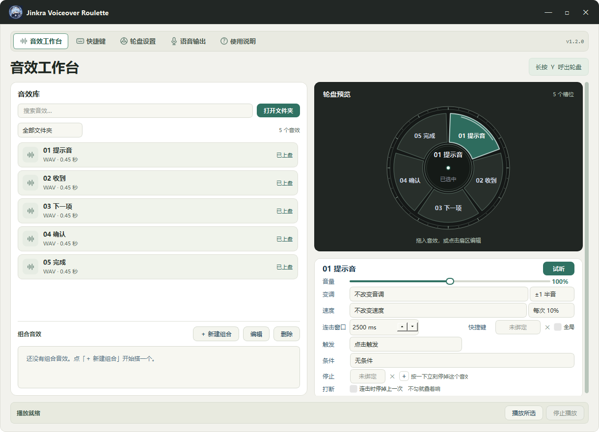
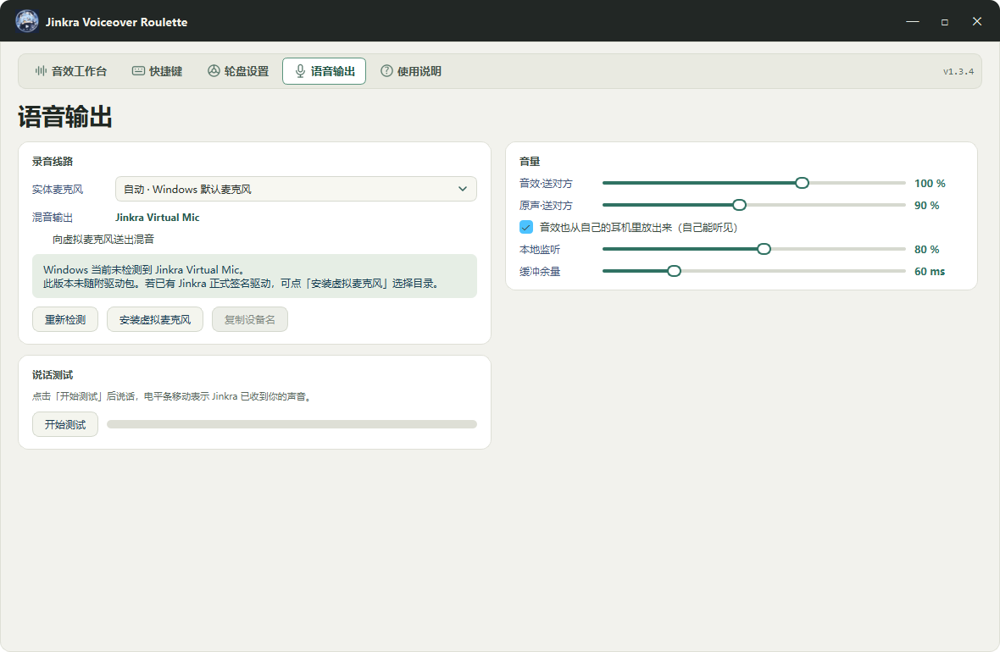
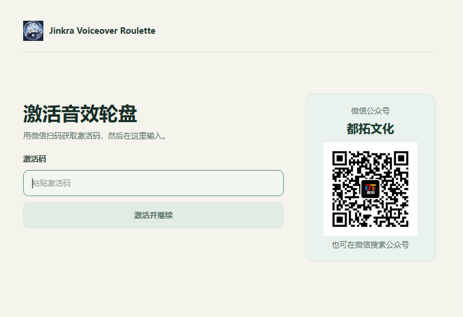
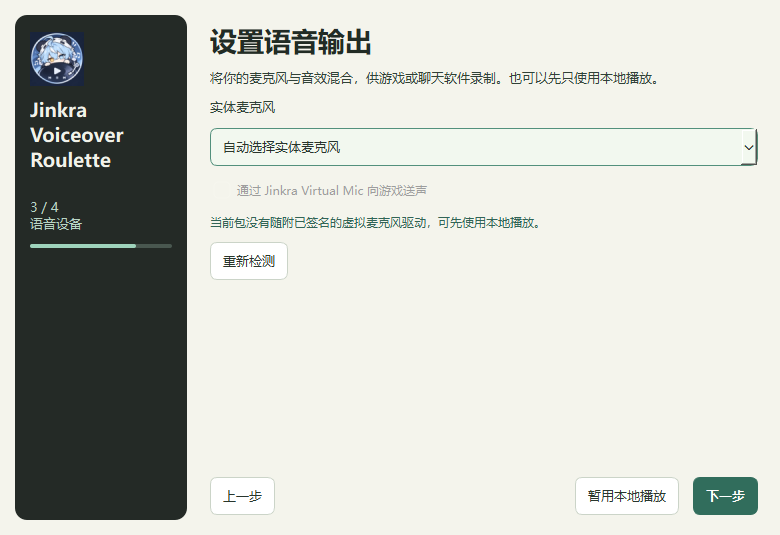

# Jinkra Voiceover Roulette

一个**游戏内音效轮盘**，任何游戏都能用。长按一个键，屏幕中间弹出轮盘，鼠标一划、松手，你放进去的语音就播出来了。

一个 Windows 音效轮盘，采用石墨灰、亚麻白和青灰配色，提供自适应工作台和带刻度的轮盘。



[查看小窗布局](docs/workbench-compact.png)

## 它有什么

- **长按弹轮盘 / 单击播放**：长按热键约 0.25 秒弹出，松开即播；轻点一下就播这个轮盘上次响过的那个（一次没播过就播第一格），不用开轮盘
- **每套轮盘绑自己的键**：给某一套轮盘单独挂一个呼出键——长按它直接弹这套盘，轻点它直接播这套盘上次那个。它**不会改掉"当前轮盘"**：松手之后主热键弹出来的还是原来那套，想永久换盘用"切换轮盘"键或托盘菜单
- **预选模式**：长按选中后先不播，只把这一格点亮；松手后轮盘收到托盘，再按一次呼出键才播。适合"先挑好、等时机到了再出声"
- **停止/暂停会淡出**：在「轮盘 → 停止与淡出」里打开并设个时长（60~2000ms），停声音不再一刀切断，而是像调音台那样拉下来，不爆音也不突兀。轮盘中心松手、托盘停止、条件停止键、长按松手都算
- **热键能绑组合键**：`Ctrl+Shift+Y` 这种也行，左右 Ctrl 不分，老的单键设置照样能用
- **能绑的东西更多了**：键盘上的字母数字、F1~F24、方向键、Home/End/PgUp/PgDn、Insert、
  小键盘整套（单独认）、减号/等号/方括号/反斜杠/反引号这些符号、PrtSc/ScrLk/Pause/菜单键；鼠标左右中键、
  两个侧键、**滚轮上/下 + 横向滚轮**（滚一格算一下）；还能**单独绑一个 Alt / Shift / Ctrl**（只按一下就绑上）
- **Xbox 手柄**：音效和组合的快捷键框点进去按一下手柄按钮就能绑；A/B/X/Y、LB/RB、LT/RT、
  十字键、摇杆按下、View/Menu 都认，蓝牙有线都行。触发方式、全局通用、条件解锁/停止照常生效
- **暂停模式**：在轮盘中心松手 = 停掉声音 + 暂停（快捷键暂时失效），再松手一次或直接选个音效就恢复
- **多套轮盘**：最多 8 套，各自独立摆位、独立颜色，一个热键循环切换
- **轮盘能调大小**：直径、中空比例、整体大小（70%~140%，内外圈和文字一起缩放）随便调；中空留白多大，中心"不选中"的范围就多大，所见即所选
- **每个音效单独调**：音量、变调（固定半音或随机范围）、速度、连击窗口、专属快捷键
- **四种触发方式**：点击触发（默认）、长按触发（松手即停）、松手触发、长按连续触发（按住按间隔一直连点，配合变调做连音）
- **条件解锁**：给音效加一道门——先按解锁键，它在「解锁时间」内、按「解锁次数」才能被触发；时间到只挡住新的，不会掐断正在响的
- **条件停止**：再给一道闸——按一下停止键，这个音效立刻哑掉并重新上锁（一个音效可配多个停止键，手边哪个好按用哪个）
- **一个键挂多个音效**：比如长按左键播组合、松手左键播另一句，各自按自己的触发方式生效
- **连击打断**：每个格子单独开关——同一个音效还没放完又按了一次，是叠着响还是先把上一声掐掉
- **快捷键能全局通用**：勾一下，这条快捷键就不再跟着轮盘走，切到别的盘照样按响（音效、组合都支持）
- **音效库好翻**：文件夹筛选下拉框 + 搜索框叠加用；长文件名自动省略号（悬停看全名），格子不会被撑宽
- **窗口能缩放**：拖边角就能改大小，关掉时记住尺寸和位置，下次打开照旧
- **不会丢配置**：写盘走临时文件 + 原子替换并留 `sounds.json.bak`；文件暂时不见了（网盘没同步、硬盘没插）只把参数收进暂存区，文件放回来自动接回原位
- **组合音效**：把几个音效串起来——延迟、升调、随机抽卡、A 播完接 B，都能排；一条最多 100 项，音效多了可以搜
- **AI 朗读**：输入文字就能读出来，自己耳机和队友都能听到。可用 Windows 自带语音（慧慧、康康、瑶瑶等），也能一键安装离线 AI 朗读包（小雅、超文、Kokoro 103 种音色），读完还能「保存为音效」放上轮盘
- **一键虚拟麦克风**：选择实体麦克风，混音后送进虚拟麦克风；程序内附带 VB-CABLE 官方驱动包，点一下就能装
- **能看见的配色**：应用主题色（界面）和轮盘颜色（轮盘本体）互相独立，都能自己取色
- **有动画，也能关**：轮盘弹出与释放都有过渡，嫌挡视线就在「轮盘 → 外观」里一键关掉
- **带说明书**：程序里就有完整教程和常见问题，不用来回翻文档



## 首次启动与更新





0. 运行 `Jinkra-Voiceover-Roulette-Setup-vX.Y.Z-x64.exe` 完成安装，从开始菜单或桌面打开。
1. 在启动向导中用微信扫描「都拓文化」二维码，获取当期激活码。激活凭据按 Windows 用户和软件版本在本地保存。
2. 使用「上一步」「下一步」浏览轮盘用法和语音设备设置。可以随时在「使用说明」或托盘菜单中重新打开向导。
3. 在「检查更新」中查看本仓库的最新版本和测试线路。元数据及 SHA-256 来自 GitHub 官方 API，下载会按实测顺序尝试 GitHub 和加速线路。校验通过后可原位更新程序，设置和音效继续使用原目录。

[下载 Windows 版和查看版本记录](https://github.com/Jinkra/Jinkra-Voiceover-Roulette/releases)

## 语音输出

启动向导和「语音输出」页都有「安装虚拟麦克风」按钮：

1. 点击按钮，确认 Windows 管理员提示。
2. 之后全自动安装：用 VB-CABLE 安装程序自带的静默参数（`-i -h`），不弹它的窗口、不打开网站。通常不用重启。
3. 程序识别到 `CABLE Input` / `CABLE Output` 后自动启用混音送声。若设备装上了但无法启动（常见于卸载后未重启就重装），程序会直接提示重启。

旁边的「清除残留」用于以前装过但没卸载干净、导致装不上的情况：以管理员身份移除 VB-CABLE 的设备（含已断开的影子设备和音频端点）、驱动库里的驱动包、驱动服务、`C:\Program Files\VB\CABLE` 和它的卸载登记，以及本软件的临时文件。只按硬件 ID `VBAudioVACWDM` 和 `ROOT\JINKRAVAD` 识别，Voicemeeter 等其他 VB-Audio 产品不受影响。完成后重启电脑再安装。在游戏或语音软件里把输入设备选为 **CABLE Output**。

虚拟声卡使用 VB-Audio 的 [VB-CABLE](https://vb-audio.com/Cable/)：它带微软签名，开着 Secure Boot 的 Windows 10/11 也能直接加载。打包时会把官方驱动包 `VBCABLE_Driver_Pack46.zip` 原样（校验 SHA-256，不做任何修改）嵌入 EXE，国内用户不需要再连 VB-Audio 官网下载。VB-CABLE 是捐赠软件，版权归 VB-Audio 所有。它的许可要求“未经作者同意，不得集成进其他软件的安装流程”，正式大规模分发前建议向 VB-Audio 取得书面许可。

### AI 朗读

工作台第二页「AI 朗读」：输入文字、选音色、调语速和音量，点「朗读」（Ctrl+Enter）。声音走和音效相同的混音：自己的耳机能听到，开启送声后队友也能从虚拟麦克风听到。长文本边合成边播放。「保存为音效」把读出来的声音存进 `sounds/朗读/`，可以拖上轮盘、绑快捷键。

- **系统语音**：调用 Windows 自带的 OneCore / SAPI 语音（[native/Tts.cs](native/Tts.cs) 编译出的 `jinkra-tts.exe`），不需要下载。
- **朗读包**：[sherpa-onnx](https://github.com/k2-fsa/sherpa-onnx)（Apache-2.0）离线神经网络语音，引擎随程序打包；模型从 sherpa-onnx 官方发布按需下载，走加速线路并按 SHA-256 校验，存放在安装目录的 `models/tts/`。
  - 小雅：中文女声，14 MB。训练数据（标贝）仅限非商业用途。
  - 超文：中文男声，14 MB。训练数据 CC0。
  - Kokoro 多音色：103 种音色（中文女声 55、男声 45、英文 3），中英混读，147 MB，Apache-2.0。

### AI 降噪

「语音输出」页的「AI 降噪」使用 [RNNoise](https://github.com/xiph/rnnoise)（BSD-3）。模型和推理库在 [pyrnnoise](https://github.com/pengzhendong/pyrnnoise)（Apache-2.0）的 Windows 包里，用户点「安装降噪模型」时才下载（约 13 MB），依次尝试清华、阿里云 PyPI 镜像和官方 PyPI，并用固定的 SHA-256 校验，存放在安装目录的 `models/rnnoise`。

仓库里还保留了自研驱动 [Jinkra Virtual Mic](native/virtual-mic/README.md) 的工程。只有取得微软签名后它才能在普通电脑上加载；构建内附带签回的驱动时，程序会优先安装它。

## 跑起来

要求 Windows 10/11 + Python 3.10 以上（开发环境是 3.13）。

```bash
pip install -r requirements.txt
python sr_roulette.py
```

双击 `run.bat` 也能启动。默认打开设置窗口，关闭窗口后继续在托盘运行。长按 `Y` 弹出轮盘。

音效文件丢进 `sounds/` 目录，回到程序点「重新扫描」，就能拖到轮盘上用了。wav / mp3 / ogg / flac / m4a 都认。

## 打包成安装包

在 Windows 上运行（需要 Python 依赖和 PyInstaller，C# 编译器使用系统自带的 .NET Framework 4.x）：

```bash
pip install pyinstaller
python gen_icon.py
python build_installer.py
```

脚本会先用 `JinkraRoulette.spec` 打包 EXE（自动校验并嵌入 VB-CABLE 官方驱动包），再生成 `release/` 下的：

- `Jinkra-Voiceover-Roulette-Setup-vX.Y.Z-x64.exe`：安装向导。默认装到 `%LOCALAPPDATA%\Programs\Jinkra Voiceover Roulette`，只为当前用户安装、不需要管理员权限，创建开始菜单和桌面快捷方式，并在「应用和功能」里登记卸载入口。
- `Jinkra-Voiceover-Roulette-vX.Y.Z-Windows-x64.zip`：应用内「检查更新」下载的包。
- 两者的 `.sha256`，以及备用发布清单 `latest.json`。

安装目录里的 `Uninstall Jinkra Voiceover Roulette.exe` 是卸载向导，默认删除整个安装目录，也可勾选保留设置、音效和激活记录，也可勾选「同时卸载虚拟麦克风」（用 VB-CABLE 安装程序自带的 `-u -h` 静默卸载，需确认管理员提示）。安装器和卸载器的源码在 [native/Setup.cs](native/Setup.cs)。已有的便携版目录可以直接选作安装目录，设置和音效原样保留。

静默安装与卸载（用于测试或部署）：

```bash
"Jinkra-Voiceover-Roulette-Setup-vX.Y.Z-x64.exe" --silent "D:\Apps\Jinkra Voiceover Roulette" --no-desktop-shortcut
"Uninstall Jinkra Voiceover Roulette.exe" --uninstall-silent "D:\Apps\Jinkra Voiceover Roulette" --remove-data --remove-vbcable
```

如果以管理员权限运行的游戏收不到热键，可用右键菜单以管理员身份启动 Jinkra Voiceover Roulette。

## 目录

```
sr_roulette.py        主程序：热键轮询、轮盘窗口、音频引擎、托盘
settings_window.py    设置窗口（音效库 / 快捷键 / 轮盘 / 麦克风 / 说明）
sounds_config.py      sounds.json 的读写、多套轮盘、组合音效的模型
theme.py              配色的唯一来源（主题色、轮盘色、深浅推导）
audio_routes.py       自动配对语音播放端和录音端
JinkraRoulette.spec   PyInstaller 打包配置
build_installer.py    生成安装包、卸载程序和更新 ZIP
native/Setup.cs       安装与卸载向导（C#）
使用说明.txt          随 exe 一起发给最终用户的说明书
sounds/               音效就放这儿
_tests/               各功能的自测脚本，每个都能单独跑
docs/                 README 用的截图
```

`_tests/` 下每个脚本都是独立的，直接 `python _tests/_t_xxx.py` 就能跑，不需要 pytest。当初写它们是为了每改一处都能立刻验证，现在一起放出来——你可以自己跑一遍，看它是不是真如上面所说。

## 示例音效

公开仓库和便携包使用合成提示音。可将自己的 WAV、MP3、OGG、FLAC 或 M4A 放入同目录下的 `sounds/` 文件夹。

发布时使用 `vX.Y.Z` 标签，上传 `build_installer.py` 生成的安装包、更新 ZIP、两者的 `.sha256` 和 `latest.json`。`latest.json` 是备用发布清单：GitHub 接口限流（HTTP 403）时，应用内更新经直连和加速线路读取它。先写好 `release/notes-vX.Y.Z.md` 再打包，说明会一并写进清单。应用内更新读取的资产名为 `Jinkra-Voiceover-Roulette-vX.Y.Z-Windows-x64.zip`，其中应用文件位于 ZIP 根目录并命名为 `Jinkra Voiceover Roulette.exe`。

## 说清楚风险

- 本程序是个人写的第三方工具，与任何游戏及其开发商、发行商**没有任何关系**，也不是任何游戏的官方工具。
- 在竞技对局里放语音可能被队友嫌弃、可能违反游戏规则、**可能被封号**。这件事只能你自己判断，作者不承担后果。
- 程序在同目录读写 `config.json`、`sounds.json` 和 `jinkra_roulette.log`。启用开机自启时会在当前用户的启动项中写入一条记录。
- 完整的安全声明在 `使用说明.txt` 和程序内「说明 → 一、安全声明」里，写得比这里细。

## 许可

[MIT](LICENSE)
